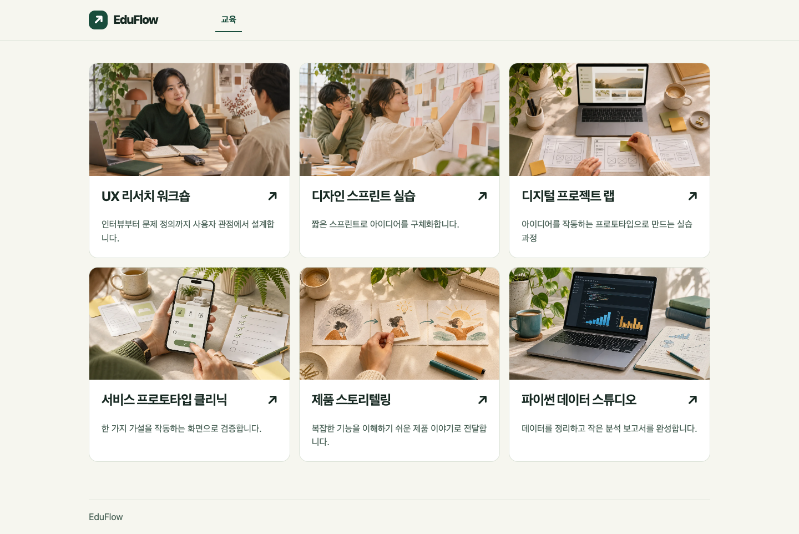

# EduFlow

교육을 둘러보고 신청할 수 있는 서비스입니다. 운영자는 접수된 신청을 관리하고,
신청자가 선택한 연락 가능일에 보낸 안내 메일의 발송 내역을 확인할 수 있습니다.



## 화면과 사용 흐름

| 순서 | 할 수 있는 일 |
| --- | --- |
| 1. 교육 둘러보기 | 교육명, 소개, 커리큘럼, 대표 이미지를 보고 신청 가능 여부를 확인합니다. 정원이 찼거나 마감일이 지난 교육도 내용을 볼 수 있습니다. |
| 2. 교육 신청 | 이름, 이메일, 주소, 연락 가능일을 입력하고 접수 결과를 확인합니다. [교육 신청 화면](docs/images/course-application.png) |
| 3. 신청 관리 | 운영자는 신청을 검색·등록·수정·삭제하고 `접수 → 확인중 → 완료` 상태를 관리합니다. 신청 상세에서 메일 발송 내역으로 이동할 수 있습니다. [운영자 신청목록 화면](docs/images/staff-applications.png) |

## 주요 기능과 설계

- **정원과 중복 접수 관리** — 마지막 한 자리에 여러 요청이 동시에 들어와도 정원을 넘지 않도록
  데이터베이스에서 접수를 순서대로 처리합니다. 통신 오류로 같은 제출을 다시 보내면 기존 접수 건을 반환합니다.
- **연락 가능일 안내** — 신청자가 선택한 날짜의 한국 시간 오전 9시에 맞춰 메일을 예약합니다.
  당일 오전 9시 이후에 신청하면 1분 주기의 다음 확인에서 처리합니다. 운영자는 발송 상태와 시각을
  조회할 수 있습니다. 화면의 `발송 완료`는 메일 백엔드가 발송 요청을 받아들인 상태입니다.
- **Google Sheets 내보내기** — 내보내기 권한이 있는 운영자는 현재 검색 결과를 한 번에
  최대 500건까지 내보낼 수 있습니다. 실행할 때마다 지정한 문서에 새 탭이 생성됩니다.

Django와 PostgreSQL은 신청과 예약을 저장합니다. 공개 화면과 운영자 화면은 JavaScript로
Django REST Framework(DRF)의 JSON API에서 데이터를 받아 표시합니다. 메일 예약 확인과
발송은 Celery가 Redis 큐를 통해 처리합니다.

## 로컬에서 실행

**준비물**은 Python 3.12, Pipenv, 실행 중인 PostgreSQL 14 이상입니다. 아래 명령은
프로젝트 폴더에서 실행합니다. PostgreSQL 계정에 로컬 데이터베이스 생성 권한이 필요합니다.

```sh
if [ ! -e .env ]; then
    (umask 077; cp .env.example .env)
fi
export PIPENV_VENV_IN_PROJECT=1
pipenv sync --dev
createdb eduflow  # 처음 한 번만 실행
pipenv run python manage.py migrate
pipenv run python manage.py seed_demo
pipenv run python manage.py createsuperuser
pipenv run python manage.py runserver
```

Django 개발 서버의 기본 주소는 `127.0.0.1:8000`입니다. 서버를 실행한 뒤 아래 주소를 브라우저 주소창에 입력합니다.

1. **교육 목록** `http://127.0.0.1:8000/`

   접수 중인 교육을 골라 예시 이름과 주소, `learner@example.com`, 오늘 또는 이후 날짜로 신청합니다.
2. **운영자 신청목록** `http://127.0.0.1:8000/staff/applications/`

   방금 만든 운영자 계정으로 로그인한 뒤, 신청을 찾아 상태를 변경해 봅니다.
3. 관리자 헤더의 **메일 발송 내역**을 엽니다. 예시 데이터에는 발송 완료·실패·취소 기록이
   들어 있습니다. 새 신청으로 메일 발송이나 Google Sheets 내보내기를 테스트하려면
   [외부 연동 안내](docs/integrations.md)를 참고하세요.

`seed_demo`는 빈 DB에 교육 6개와 예시 신청·메일 이력 각 16건을 생성합니다. 정원 마감과
신청 기간 종료 사례를 포함하며, 예시 내역 생성 과정에서 메일은 발송되지 않습니다.
기본 소켓 연결과 다른 PostgreSQL 환경이라면 [.env.example](.env.example)의 DB 설정을 참고하세요.

## 주요 API

| 메서드·경로 | 용도 |
| --- | --- |
| `GET /api/v1/courses/` | 공개 교육 목록 |
| `GET /api/v1/courses/<slug>/` | 교육 소개와 접수 상태 |
| `POST /api/v1/applications/` | 교육 신청 접수 |
| `GET /api/v1/applications/staff-results/` | 운영자 신청 목록과 검색 |
| `POST /api/v1/applications/export/` | Google Sheets 내보내기 |

인증, 검색 조건, 상세 엔드포인트는 [기술 참고](docs/technical-reference.md)에 정리했습니다.

## 기능 검증

```sh
pipenv run pytest
```

별도 PostgreSQL 테스트 DB에서 **41개 테스트**를 통과했습니다. 정원 경쟁과 중복 접수,
운영자 권한, 같은 메일 예약이 중복으로 들어왔을 때의 재처리 방지, 발송 재시도,
Sheets 요청을 검증했습니다. 직접 신청해 안내 메일 수신과 Google Sheets의 새 탭 생성을
확인했습니다.

## AI 코딩 보조 도구 사용 내역과 활용 이유

OpenAI Codex를 설계 대안 검토, 구현, 테스트 작성, 오류 진단과 PR 코드 리뷰에 사용했습니다.
프로젝트 작성자가 접수 규칙, 관리자 화면의 사용 흐름, 예약 발송 방식과 코드 구조를
결정했습니다. Codex는 결정 사항을 코드와 테스트에 반영하고, 확인이 필요한 동작을 정리했습니다.

| 활용한 작업 | 도구를 사용한 이유와 검증 방법 |
| --- | --- |
| 접수 흐름 설계 | 마감 시각에 도달하거나 마지막 한 자리에 여러 사람이 동시에 신청하는 경우를 설계 단계에서 확인했습니다. 동시 요청 중 한 건만 접수되고, 같은 요청을 다시 보내면 기존 신청이 반환되는지 PostgreSQL 테스트로 검증했습니다. [접수 테스트](eduflow/apps/applications/tests.py) · [신청 API 테스트](tests/test_application_flow.py) |
| 운영자 화면과 API 구현 | 검색, 상세 편집, 발송 내역을 같은 데이터 흐름으로 연결하는 데 활용했습니다. 로그인 여부와 권한에 따른 접근 차이는 자동 테스트로, 신청 검색 결과와 메일 발송 내역 상세는 브라우저로 확인했습니다. [운영자 테스트](tests/test_staff_applications.py) |
| 메일 예약과 오류 진단 | 예약 시각 계산, 동일 작업 재수신, 실패 후 재시도를 테스트로 고정했습니다. 실제 발송이 실패했을 때는 SMTP 서버 연결과 계정 인증을 분리해 확인했고, 실제 받은편지함 수신은 작성자가 직접 확인했습니다. [메일 예약 테스트](tests/test_application_reminders.py) |
| Google Sheets 내보내기 | 화면에서 조회한 조건이 그대로 반영되는지, 권한 없는 요청을 차단하는지, 수식처럼 보이는 신청자 입력이 문자열로 저장되는지 모의 API 요청으로 확인했습니다. 서비스 계정 구성을 마친 뒤 작성자가 실제 시트에서 새 탭 생성을 확인했습니다. [내보내기 테스트](tests/test_sheets_export.py) |
| PR 코드 리뷰 | 병합 전에 동시 신청과 정원 처리, 운영자 권한, 메일 재시도를 점검하는 데 활용했습니다. 메일 서버가 발송 요청을 수락한 직후 Worker가 중단되면 같은 메일이 재시도될 수 있다는 점은 PR에 남겼습니다. 같은 예약 작업이 중복으로 들어왔을 때의 재처리 방지와 발송 실패 후 재시도는 pytest로 확인했습니다. [PR #1 리뷰](https://github.com/rookieno/EduFlow/pull/1#pullrequestreview-6086449964) |

AI가 작성한 코드의 주요 경로는 Given–When–Then 형식의 pytest로 반복 검증했습니다.
외부 서비스는 모의 요청으로 예외 상황을 재현하고, 실제 발송과 내보내기는 별도로
실행해 확인했습니다.

## AWS 사용 및 배포 계획

- [AWS 사용 계획](docs/aws-usage-plan.md)에서 서비스 구성, 선택 이유와 비용 항목을 확인할 수 있습니다.
- [AWS 배포 구성](docs/aws-deployment.md)에 운영 설정, 배포 순서, 검증과 복구 절차를 정리했습니다.
