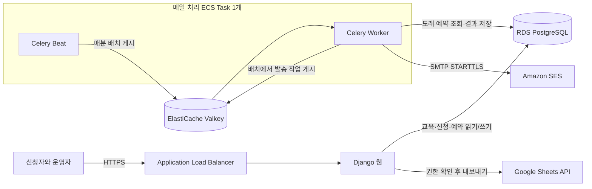

# EduFlow AWS 사용 계획

[프로젝트 소개](../README.md) · [배포 구성과 운영 절차](aws-deployment.md)

EduFlow는 교육과 신청 데이터를 저장하고, 신청자가 선택한 연락 가능일에 안내 메일을
발송합니다. 운영자는 같은 웹 서비스에서 신청 및 메일 발송 내역을 조회하고 Google
Sheets로 신청 목록을 내보냅니다. AWS 운영안은 초기 소규모 트래픽과 한국 사용자를
기준으로 설계했습니다. 아래는 배포 제안이며 검증은 현재 로컬 환경까지 완료했습니다.

## 서비스 구성과 선택 이유

| 서비스 | 주요 특징 | EduFlow에서 맡는 역할 | 선택 이유 |
| --- | --- | --- | --- |
| Amazon ECS | 컨테이너 실행 개수를 유지하고 Task 정의를 바탕으로 서비스를 배포합니다. [공식 문서](https://docs.aws.amazon.com/AmazonECS/latest/developerguide/application_architecture.html) | Django 웹 서비스와 메일 처리 서비스를 운영합니다. 메일 처리 Task 하나에 Worker와 Beat 컨테이너를 둡니다. | 웹만 독립적으로 확장할 수 있고, 메일 처리 Task를 한 개로 유지해 Beat를 중복 실행하지 않는 배포 구성을 만들 수 있습니다. |
| AWS Fargate | 서버 인스턴스를 직접 운영하지 않고, Task별 CPU와 메모리를 지정해 컨테이너를 실행합니다. [공식 문서](https://aws.amazon.com/fargate/) | ECS의 웹, 메일 처리, DB 마이그레이션 Task를 실행합니다. | 작은 운영 환경에서 EC2의 용량 관리와 OS 패치를 줄이고, 마이그레이션은 배포할 때만 실행할 수 있습니다. |
| Amazon ECR | 컨테이너 이미지를 저장하는 관리형 레지스트리입니다. IAM으로 이미지 접근 권한을 제어합니다. [공식 문서](https://docs.aws.amazon.com/AmazonECR/latest/userguide/what-is-ecr.html) | 배포용 EduFlow 이미지를 저장합니다. | 웹·Worker·Beat·마이그레이션에 같은 이미지 digest를 지정해 코드와 의존성 버전을 맞추고, 문제가 생기면 이전 이미지를 다시 사용할 수 있습니다. |
| Application Load Balancer | HTTP·HTTPS 요청을 처리하고, 상태 확인을 통과한 대상에 트래픽을 분산합니다. [공식 문서](https://docs.aws.amazon.com/elasticloadbalancing/latest/application/introduction.html) | 공개 HTTPS 연결을 받아 사설 서브넷의 Django 웹 Task에 전달합니다. | 웹을 두 가용 영역에 배치하고도 사용자에게 주소 하나만 제공하며, 배포 중 준비되지 않은 Task에 요청이 전달되는 것을 줄입니다. |
| AWS Certificate Manager (ACM) | 공개 TLS 인증서를 발급하고, 갱신 요건을 충족한 인증서를 관리합니다. [공식 문서](https://docs.aws.amazon.com/acm/latest/userguide/acm-overview.html) | EduFlow 도메인의 인증서를 ALB에 연결합니다. | 신청자 정보가 오가는 연결에 HTTPS를 적용하고, 웹 컨테이너마다 인증서를 배포·갱신하는 작업을 줄일 수 있습니다. |
| Amazon Route 53 | 관리형 DNS로, Alias 레코드를 통해 도메인을 ALB에 연결할 수 있습니다. [공식 문서](https://docs.aws.amazon.com/Route53/latest/DeveloperGuide/routing-to-elb-load-balancer.html) | EduFlow 도메인을 ALB에 연결합니다. 기존 DNS가 있으면 그대로 사용할 수 있습니다. | ALB의 개별 IP를 관리하지 않고 일정한 서비스 주소를 제공할 수 있습니다. |
| Amazon VPC | 서브넷, 라우팅, 보안 그룹으로 리소스 간 연결을 제어하는 독립 네트워크입니다. [공식 문서](https://docs.aws.amazon.com/vpc/latest/userguide/what-is-amazon-vpc.html) | 공개 서브넷에는 ALB를 두고 앱과 데이터 저장소는 사설 서브넷에 배치합니다. | 외부에서 접근할 입구를 ALB로 한정하고, 신청자의 개인정보를 저장하는 RDS에는 필요한 Task만 접근하도록 제한할 수 있습니다. |
| NAT Gateway | 사설 서브넷의 리소스가 외부로 연결할 수 있게 하는 관리형 네트워크 구성 요소입니다. [공식 문서](https://docs.aws.amazon.com/vpc/latest/userguide/vpc-nat-gateway.html) | 웹의 Google Sheets API, Worker의 SES SMTP, Task 시작 시 필요한 외부 연결 경로를 제공합니다. | 웹과 메일 처리 Task에 공개 IP를 부여하지 않고도 외부 연동을 유지할 수 있습니다. |
| Amazon RDS for PostgreSQL | 관리형 PostgreSQL로 자동 백업, 시점 복구, Multi-AZ 배치를 지원합니다. [공식 문서](https://docs.aws.amazon.com/AmazonRDS/latest/UserGuide/Welcome.html) | 교육·신청·메일 예약과 처리 결과의 원본 데이터를 저장합니다. | 기존 PostgreSQL의 행 잠금과 제약으로 접수 상태를 일관되게 확인하고 동일한 제출 요청을 한 번만 처리할 수 있습니다. DB 백업과 복구도 운영 계획에 포함할 수 있습니다. |
| Amazon ElastiCache for Valkey | Valkey를 운영하는 관리형 인메모리 서비스입니다. 노드 기반 구성에서 복제와 전송 암호화를 사용할 수 있습니다. [공식 문서](https://docs.aws.amazon.com/AmazonElastiCache/latest/dg/WhatIs.html) | Beat가 등록한 배치 작업과 Worker가 등록한 개별 발송 작업을 Celery 큐에 보관합니다. | 현재 Celery의 Redis 전송 방식과 가까워 코드 변경 범위를 줄일 수 있습니다. 예약 원본은 PostgreSQL에 두고 Valkey 호환성은 배포 전에 검증합니다. |
| Amazon SES | SMTP와 API로 메일을 보낼 수 있고, 발신 도메인 검증과 발송 이벤트 모니터링을 지원합니다. [공식 문서](https://docs.aws.amazon.com/ses/latest/dg/Welcome.html) | 연락 가능일 안내 메일을 보내고 반송과 수신 거부를 확인합니다. | 기존 Django SMTP 백엔드를 설정만 바꿔 사용할 수 있고, 앱에서 기록한 발송 요청 수락과 이후 수신 서버 전달·반송을 구분해 추적할 수 있습니다. |
| AWS Secrets Manager | 비밀을 암호화해 저장하고 접근과 버전을 관리합니다. [공식 문서](https://docs.aws.amazon.com/secretsmanager/latest/userguide/intro.html) | DB 비밀번호, 브로커 연결 정보, SMTP 인증 정보, Google 서비스 계정 키를 보관합니다. | 코드나 컨테이너 이미지에 비밀을 넣지 않고, 검증용과 운영용 값을 분리해 교체할 수 있습니다. |
| AWS IAM | 역할과 정책으로 AWS 리소스 접근을 제한하고 임시 자격 증명을 제공합니다. [공식 문서](https://docs.aws.amazon.com/IAM/latest/UserGuide/id_roles.html) | ECS 이미지 다운로드·로그 기록에 쓰는 실행 역할과 애플리케이션의 Task 역할을 관리합니다. | 메일 처리 Task에는 Google 키를 읽을 권한을 주지 않는 등, 서비스가 자기 작업에 필요한 리소스에만 접근하도록 할 수 있습니다. |
| Amazon CloudWatch | AWS 서비스와 애플리케이션의 로그·지표를 수집하고 알림을 설정할 수 있습니다. [공식 문서](https://docs.aws.amazon.com/AmazonCloudWatch/latest/monitoring/WhatIsCloudWatch.html) | 웹 오류, Task 재시작, DB 연결 수, 예약 지연과 SES 반송 지표를 확인합니다. | 웹이 정상이어도 메일 처리만 지연될 수 있으므로, 웹과 예약 처리 문제를 각각 발견하고 진단할 수 있습니다. |
| AWS Budgets | 예산 대비 실제 비용과 예상 비용이 설정한 기준에 도달할 때 알림을 보냅니다. [공식 문서](https://docs.aws.amazon.com/cost-management/latest/userguide/budgets-managing-costs.html) | 검증 환경과 운영 환경의 비용을 추적하고 월 예산 기준 알림을 보냅니다. | 요청이 적어도 ALB·NAT·DB처럼 계속 비용이 발생하는 리소스가 있어, 예산을 넘기 전에 구성을 조정할 수 있습니다. |

운영 리전은 **서울 `ap-northeast-2`**를 기준으로 잡습니다. 교육 콘텐츠의 기본 이미지와
정적 파일은 현재 저장소에 포함돼 있어 같은 도메인의 웹 서비스에서 제공합니다. 관리자
직접 업로드나 대용량 정적 파일 전송이 필요해지면 S3와 CloudFront 도입을 검토합니다.
Google Sheets는 AWS 외부의 연동이며 대상 문서는 운영자에게만 공유합니다.
[서울 SES 엔드포인트](https://docs.aws.amazon.com/general/latest/gr/ses.html)

## 요청과 메일 흐름

신청이 저장될 때 한국 시간 오전 9시로 메일을 예약합니다. Beat는 매분 배치를
게시하고 Worker가 데이터베이스에서 도래한 예약을 읽어 발송합니다. 브로커가
재시작되면 DB에 남은 발송 가능한 예약을 이후 스캔에서 다시 찾습니다. 발송 요청이
메일 서버에 수락된 직후 Worker가 중단되면 동일 메일이 재시도될 수 있으므로,
운영에서 결과가 불명확한 건은 발송 내역과 SES 로그를 확인합니다.

## 운영 규모와 비용 계획

| 항목 | 검증 환경 | 운영 환경 |
| --- | --- | --- |
| 웹과 발송 | 웹 Task 1개와 메일 처리 Task 1개. 예시 데이터와 테스트 주소로 점검합니다. | 웹 Task 2개를 서로 다른 가용 영역에 분산합니다. 메일 처리 Task는 1개로 시작하고, 지연이 지속되면 Beat를 1개로 유지한 채 Worker만 추가할 수 있게 구성합니다. |
| DB와 브로커 | 비용을 줄이기 위해 RDS Single-AZ와 Valkey 단일 노드로 시작할 수 있습니다. | RDS Multi-AZ와 Valkey 복제본·자동 장애 조치를 구성합니다. |
| 네트워크 | 테스트 환경은 필요할 때만 가동합니다. | ALB는 공개 서브넷에, 애플리케이션과 데이터 저장소는 사설 서브넷에 둡니다. 각 앱 가용 영역에서 외부 연동에 필요한 NAT 경로를 확보합니다. |
| 이메일과 Sheets | SES 샌드박스의 검증된 수신자와 테스트 시트를 사용합니다. | 검증된 발신 도메인과 운영용 시트를 사용하고, SES 프로덕션 발송 권한을 확보합니다. |

월 비용은 Fargate의 Task별 CPU·메모리와 실행 시간, ALB 사용량, RDS와 Valkey의
인스턴스·저장 용량, NAT 시간·전송량, SES 발송량, 로그·비밀 저장 사용량으로 산정합니다.
Task를 중지해도 남아 있는 ALB나 NAT의 비용이 발생할 수 있으므로, 장기간 사용하지
않는 검증 환경은 인프라 템플릿에서 다시 만들 수 있게 구성합니다.
서울 리전 요금으로 검증·운영 구성을 각각 계산하고, AWS Budgets에 합의한 월 예산의
50%, 80%, 100% 알림을 설정합니다. 실제 트래픽과 예산이 정해지면 구성과 규모를
다시 결정합니다. [AWS Pricing Calculator](https://calculator.aws/)

## 장애 대응과 확장 기준

- **웹** — 오류율과 응답 시간, ALB 대상 상태를 모니터링합니다. 부하가 지속되면 웹을 추가하고 DB 연결 수를 함께 확인합니다.
- **메일** — Worker가 기록하는 미처리 예약의 개수와 가장 오래 지연된 시간을 관측합니다. 예약 후 첫 시도 지연이 5분을 넘는 상태가 지속되면 브로커 연결, Worker, SMTP 오류를 순서대로 확인합니다. SES 반송과 스팸 신고율을 따로 확인합니다.
- **데이터** — RDS 자동 백업 보존기간은 운영 초기 7일로 잡고, 복구 연습으로 필요한 보존 기간과 복구 목표를 다시 정합니다. 복원 환경에서는 실제 메일 발송을 중지하고 교육·신청·예약의 정합성을 검증합니다. [RDS 백업과 시점 복구](https://docs.aws.amazon.com/AmazonRDS/latest/gettingstartedguide/managing-backup-restore.html)
- **개인정보** — 운영 및 검증용 DB·시트·서비스 계정을 분리합니다. 신청자의 이름·이메일·주소, SMTP 비밀번호와 Google 키는 애플리케이션 로그에 기록하지 않습니다. DB와 백업에 저장 암호화를 적용합니다.

## 검토한 대안

- **Worker와 Beat를 별도 ECS 서비스로 실행** — Worker만 자동 확장하거나 독립적으로 배포해야
  할 때 유리합니다. 초기에는 메일 처리 Task 하나를 운영하는 편이 단순합니다. 초기 구성에서는
  두 컨테이너를 함께 교체하므로 장애 복구와 배포 중 예약 처리가 잠시 지연될 수 있습니다.
  발송량이 늘어 독립 확장이 필요해지면 Worker 전용 서비스를 분리합니다.
  [ECS 애플리케이션 구성](https://docs.aws.amazon.com/AmazonECS/latest/developerguide/application_architecture.html)
- **AWS Elastic Beanstalk Standard 모드** — EC2 기반으로 웹 앱의 배포, 상태 확인,
  로드밸런서와 자동 확장을 관리할 수 있습니다. 서울 리전 Linux x86 온디맨드 730시간을
  기준으로 웹 2대와 메일 처리 1대를 각각 `t3.small`과 gp3 10 GiB로 구성하면 월
  약 **$59.68**입니다. 현재 Fargate 3개 Task의 **$62.17**과 차이는 약 **$2.50**이며,
  두 금액에서 ALB·NAT·DB·브로커·메일 등 공통 비용과 EC2 CPU 크레딧 추가 요금은 제외했습니다.
  EC2 한 대에 웹과 메일 처리를 함께 두면 약 **$19.89**로 줄지만, 인스턴스 장애 시
  두 기능이 함께 중단됩니다. Beanstalk의 기본 Worker 환경은 SQS 메시지를 앱에 HTTP
  요청으로 전달하므로 현재 Celery Worker와 Beat를 쓰려면 별도로 구성해야 합니다.
  EduFlow는 이중화 구성의 비용 차이가 작고 Celery 실행 단위를 직접 관리하기 쉬워
  ECS + Fargate를 운영안으로 유지합니다.
  [Beanstalk 요금](https://aws.amazon.com/elasticbeanstalk/pricing/) ·
  [Beanstalk Worker 환경](https://docs.aws.amazon.com/elasticbeanstalk/latest/dg/using-features-managing-env-tiers.html) ·
  [서울 ECS 요금표](https://pricing.us-east-1.amazonaws.com/offers/v1.0/aws/AmazonECS/current/ap-northeast-2/index.json) ·
  [서울 EC2 요금표](https://pricing.us-east-1.amazonaws.com/offers/v1.0/aws/AmazonEC2/current/ap-northeast-2/index.json)
- **EC2 단일 인스턴스와 Docker Compose** — 짧은 시연이나 소규모 검증에는 배포가 단순합니다.
  운영에서는 인스턴스 장애와 패치의 영향이 웹·발송에 함께 미치므로 Fargate를 선택했습니다.
- **SQS를 Celery 브로커로 사용** — 큐 인스턴스 관리 부담을 줄일 수 있지만 브로커 설정과
  메시지 재전달 동작을 새로 검증해야 합니다. 초기에는 기존 Redis 전송과 가까운 Valkey를
  사용합니다.
- **기존 SMTP 서비스 유지** — Django 설정만 바꿔 유지할 수 있습니다. 운영에서 발신 도메인
  관리와 반송 지표를 AWS 구성에 통합하기 위해 SES를 기본으로 잡습니다.
